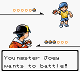
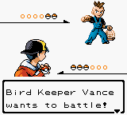
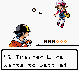
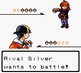
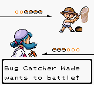
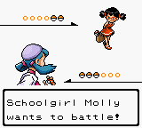
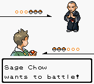
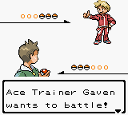
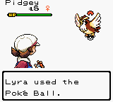

# Pokémon Polished Crystal DX

**Pokémon Polished Crystal DX** is a graphics enhancement project for [Pokémon Polished Crystal](https://github.com/Rangi42/polishedcrystal), the ROM hack by Rangi42 and its contributors built on [the Pokémon Crystal disassembly](https://github.com/pret/pokecrystal).

**DX is a work in progress and is planned for release as a patch for the next official Polished Crystal release.**

Our goal is to refresh Polished Crystal's graphics while keeping its gameplay, content, mechanics, and quality-of-life features broadly the same. The patch focuses on:

- **Colorized trainer sprites in battle.**
- **A brand-new overworld look**, based on the Gen 3 demake maps created by **Rangi42 and Luna**.
- **Further graphical enhancements** throughout the adventure.

The DX patch also converts Polished Crystal from the **MBC3 mapper to MBC30**, expanding the ROM to **4 MiB** to make room for the enhanced graphics. Playing DX requires an emulator or flashcart with MBC30 support.

DX is a separate patch project. Credit for the original game and its features goes to the Polished Crystal team, and credit for the Gen 3 demake maps goes to Rangi42 and Luna.

## Download and Play

The DX patch is still in development and will target the **next official Polished Crystal release**. The links below are for earlier releases of the **official Polished Crystal base game**; they are provided for reference and are not DX downloads.

- **[Download the official Polished Crystal v3.2.3 base game](https://github.com/Rangi42/polishedcrystal/releases/tag/v3.2.3)**

The earlier official v3.1.1 release is available [here](https://github.com/Rangi42/polishedcrystal/releases/tag/v3.1.1) (February 1, 2025).

## MBC30 Cartridge Type

**Important:** Pokémon Polished Crystal DX uses the **MBC30 mapper** (4 MiB ROM size) instead of the original Polished Crystal's MBC3 (2 MiB). This change provides additional space for the patch's enhanced graphics.

### What This Means for Players

**Emulator Compatibility:**
- ✅ **Recommended Emulators** (Full MBC30 Support):
  - **BGB** (best for development and testing)
  - **mGBA**
  - **SameBoy**
  - **RetroArch** (with SameBoy core)
- ⚠️ **Partial Support:**
  - Gambatte (may have issues with extended banks)
  - GearBoy
- ❌ **Not Compatible:**
  - Visual Boy Advance (VBA)
  - Game Boy Color Virtual Console

**Flash Cart Compatibility:**
- ✅ **EverDrive GB X7** (with recent firmware)
- ✅ **BennVenn carts** (with MBC30 support)
- ✅ **Custom MBC30 flash carts**
- ⚠️ **EverDrive GB** (older models) may require firmware update

### Technical Details

- **ROM Size:** 4MB (256 banks × 16KB)
- **Banks Used:** Currently ~100 banks, with 32 pre-allocated for expansion (banks 128-159)
- **Backward Compatibility:** Banks 0-127 work identically to the original MBC3 implementation
- **RTC Support:** Real-Time Clock functionality is preserved

The MBC30 mapper was used in the Japanese version of Pokémon Crystal, making this a fitting choice for this enhanced version of the game.

## What's New in the Polished Crystal v3.2.3 Base Game

Below is a brief summary of the base game's major changes and additions. These are Polished Crystal features that DX aims to preserve alongside its graphical enhancements.

- **Customizable New Game Setup:** You can now toggle Natures and Abilities on/off, choose how EVs work (classic no-limit, modern 510 limit, or disabled), and configure various other gameplay options before starting a new adventure.
- **DVs No Longer Determine Natures/Shininess/Gender/Unown Form:** DVs still affect color variation (slightly different hues for the same species), but everything else is now handled separately.
- **Overhauled Battle Engine and HUD:**
  - Abilities are now supported.
  - Moves have been updated to behave more like their modern counterparts.
  - Minor HUD improvements make battles more streamlined.
- **Revamped Move Animations:** Many moves have updated animations.
- **Optimized Engine and 60fps Overworld:** The game engine has been heavily optimized for smoother performance, and the overworld now runs at 60 frames per second.
- **Storage System Redesign:** The PC storage interface is more like modern Pokémon games. You can switch boxes, move Pokémon around, and manage your party with minimal saving hassles.
- **HGSS-Inspired Pokédex:** The new Pokédex includes base stats, egg groups, and a more comprehensive encounter map showing *all* methods of obtaining Pokémon.
- **Enhanced Overworld Weather:** Instead of just darkening the screen, you’ll now see proper rain, snow, or sandstorms in applicable areas.
- **Revamped Summary Screen:** Replaces the vanilla stats screen. Shows nature, abilities, seen and caught data, and more.

## Features

A full list of the underlying Polished Crystal features is in [FEATURES.md](FEATURES.md). DX aims to keep these features overall the same while enhancing the graphics. Some highlights:

- **289 Pokémon species**, including some new evolutions, plus **56 cosmetic forms** (e.g., Magikarp patterns, Pikachu Fly/Surf, Arbok patterns, Unown Forms) and **46 variants** (Alolan, Galarian, Hisuian, etc.)—for a total of **391 unique Pokémon**.
- **73 new moves** (72 on faithful builds), **75 TMs**, and **31 move tutors**.
- Modern mechanics, such as the **Fairy type**, **Physical/Special split**, **Natures**, **Abilities**, and more.
- **Unlimited TMs** and quality-of-life features like **Running Shoes** and continuous **Repel**.
- **New/Revamped Maps**: Some from R/B/Y, some devamped from HG/SS, plus original locations.
- **New Characters** including Lorelei and Agatha (R/B/Y), Lyra and the Team Rocket Executives (HG/SS), and others.
- **More Post-Game Content**: Gym Leader rematches, a new event after battling Red, and more.
- **Improved Level Curve** with steadily increasing challenges.
- **Music and Graphics** devamped from newer generations.

## Discussion

The following are community links for the original Polished Crystal project. (Read the [FAQ](FAQ.md) first if you have general questions!)

- [Discord](https://discord.gg/ZK5pqK8)
- [Skeetendo](https://hax.iimarckus.org/topic/6874/)
- [PokéCommunity](http://www.pokecommunity.com/showthread.php?t=373172)
- [Romhack.me](http://www.romhack.me/polishedcrystal/wall/)
- [/r/PokemonROMHacks](https://www.reddit.com/r/PokemonROMhacks/comments/51kbcn/pok%C3%A9mon_polished_crystal_200/)
- [Nuzlocke Forums](http://s7.zetaboards.com/Nuzlocke_Forum/topic/11003710/)
- [Pokémon Hackers Online](http://www.pokemonhackersonline.com/showthread.php?t=15811)

Additional resource:

- [PolishedDex](https://www.polisheddex.app/) — An online companion for Polished Crystal. PolishedDex provides a searchable Pokédex, move list, item list, locations, abilities, special events, and a team builder. It also includes a FAQ and links to the official ROM releases, making it a convenient reference while playing.

## Screenshots

### Pokémon Polished Crystal DX

### Pokémon Polished Crystal

  

  

  

  

  

  

  

  

  

  

